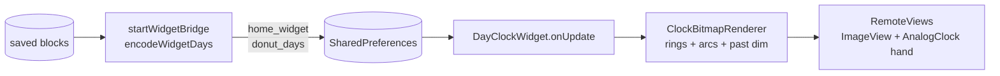

# Android home-screen widget

## What

A 2×2 resizable widget showing today's day dial: inner ring AM, outer ring PM, entries in
their colours, the part of the day already gone dimmed. A live hour hand sits on top.
Tapping it opens the app.

## How

- **Dart side** (`lib/features/widget_bridge/widget_bridge.dart`):
  - `startWidgetBridge` listens to saved entries for today and tomorrow.
  - On every change it writes `encodeWidgetDays(...)`, i.e.
    `{"<epochDay>": [[startMin, endMin, argb], ...]}` clipped per day, under the key
    `donut_days` via `home_widget`, then asks the widget to update.
  - Colours are resolved in Dart (entry → activity → hash fallback), so Kotlin doesn't
    repeat the colour rules.
- **Kotlin side** (`android/app/src/main/kotlin/dev/rudra/donut/`):
  - `DayClockWidget : HomeWidgetProvider` reads today's array (by `LocalDate.now()` epoch
    day) and calls `ClockBitmapRenderer.render(entries, 480, nowMinute)`.
  - It sets the bitmap on an `ImageView` and wires a launch intent.
  - `updatePeriodMillis` is 30 minutes, so the dimming advances and the dial turns over at
    midnight (tomorrow's data is already stored) without the app running.
- `res/layout/day_clock_widget.xml`: the bitmap with an `AnalogClock` on top. The clock has
  a transparent dial, a custom hour hand and an empty minute hand (`widget_hand_none`).

## Why

- A Flutter-rendered widget (rendering a widget tree to an image from Dart) needs the
  Flutter engine to wake up on every update. Drawing the rings natively with Android
  Canvas is a few dozen lines and runs inside the widget's own update.
- `RemoteViews` can't animate a custom hand, but `AnalogClock` animates itself and its
  12-hour face lines up exactly with the AM/PM rings, so the hand is always live while the
  bitmap only needs refreshing every half hour.
- Storing tomorrow too lets the midnight update show the new day's plan with the app closed.

**Not yet verified on a device:** the APK builds and the encoding is unit-tested, but the
widget hasn't been placed on the phone yet.
