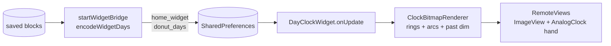

# Android home-screen widget

## What

Two 2×2 resizable widgets in the picker, both with a live analog clock on top: hour and
minute hands, plus a second hand on Android 12+. Tapping either opens the app.

- **Donut · day:** today's day dial, inner ring AM and outer ring PM, entries in their
  colours, time already gone dimmed.
- **Donut · hour:** this hour inside, the next hour outside (faded, with a small "11 AM"
  tag), like the app's hour dial. Numerals are 00/15/30/45.

## How

- **Dart side** (`lib/features/widget_bridge/widget_bridge.dart`):
  - `startWidgetBridge` listens to saved entries for today and tomorrow.
  - On every change it writes `encodeWidgetDays(...)`, i.e.
    `{"<epochDay>": [[startMin, endMin, argb], ...]}` clipped per day, under the key
    `donut_days` via `home_widget`, then asks the widget to update.
  - Colours are resolved in Dart (entry → activity → hash fallback), so Kotlin doesn't
    repeat the colour rules.
- **Kotlin side** (`android/app/src/main/kotlin/dev/rudra/donut/`):
  - `DonutClockWidget : HomeWidgetProvider` is shared by `DayClockWidget` and
    `HourClockWidget`.
    - The day view renders today's array (`renderDay`).
    - The hour view renders today's and tomorrow's (tomorrow shifted by 1440), so at
      23:xx the outer ring shows tomorrow's first hour (`renderHour`).
  - Each update books the next one with a non-waking `AlarmManager.RTC` `setWindow`: the
    next 15-minute boundary (day view) or 5-minute boundary (hour view). The dimming
    advances, the hour view turns over on the hour, and the day view turns over at
    midnight without the app running. `onDisabled` cancels the alarm.
    `updatePeriodMillis` (30 min) stays as a backstop.
- `res/layout/day_clock_widget.xml`: the bitmap with an `AnalogClock` on top: transparent
  dial, `widget_hand_hour` / `_minute`, and `_second` (API 31+, ignored before). The
  drawables are 400 dp so `AnalogClock`, which only ever scales down, always fits them to
  the widget. At their first 200 dp size, a widget resized above 200 dp got undersized
  hands.

## Why

- A Flutter-rendered widget (rendering a widget tree to an image from Dart) needs the
  Flutter engine to wake up on every update. Drawing the rings natively with Android
  Canvas is a few dozen lines and runs inside the widget's own update.
- `RemoteViews` can't animate a custom hand, but `AnalogClock` animates itself and its
  12-hour face lines up exactly with the AM/PM rings. In the day view the hour hand points
  at "now" on the rings; in the hour view the minute hand does. The hands are always live
  while the bitmap only needs refreshing every few minutes.
- The first version had only a red hour hand. The user asked for "a proper analog clock
  in center, in app and in widget", and for an hour-view widget. Two providers, rather
  than a configuration screen, let both be placed side by side from the picker with no
  extra UI.
- Storing tomorrow too lets the midnight update show the new day's plan with the app closed.

**Not yet verified on a device:** the APK builds and the encoding is unit-tested, but the
widget hasn't been placed on the phone yet.
