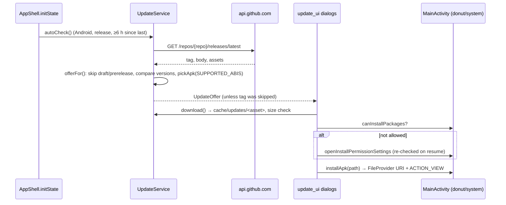

# Android in-app updates from GitHub Releases

## What

The Android app checks GitHub Releases (`rudrahnpatel/donut`) for a newer version, prompts
(Later / Skip this version / Update), downloads the APK with progress and opens the system
installer. Silent install is impossible for a normal app: Android's install confirm screen is
the expected end state. Release builds are now signed with a dedicated release key.

## How

- `lib/features/update/update_logic.dart`: pure, unit-tested (`test/update/`). `AppVersion`
  parses `v1.2.3` / `1.2.3+45`; compares name, then build number only when both sides have one.
  `ReleaseInfo.fromJson`, `pickApk` (split APK for the first device ABI, else a universal one;
  `x86` is checked after `x86_64` so it doesn't match it), `offerFor`. `updateRepo` is
  `String.fromEnvironment('DONUT_UPDATE_REPO', defaultValue: 'rudrahnpatel/donut')`; empty
  disables updates.
- `update_service.dart`: HTTP with `Accept: application/vnd.github+json` and a `User-Agent`;
  404 = no releases yet. Streamed download (`browser_download_url` redirects) to `.part`,
  length must equal the asset `size`, then rename; a finished download is reused (some devices
  kill the app when "Install unknown apps" is toggled). Last-check time and skipped tag live in
  the device-local `local_kv` table, not the synced settings.
- `update_ui.dart`: start-up check (skipped in debug builds: they're debug-signed and Android
  would refuse the update), manual check from Settings › About (ignores the throttle and skips),
  prompt and download dialogs.
- Android: `MainActivity` gains `supportedAbis`, `canInstallPackages`,
  `openInstallPermissionSettings`, `installApk` on the existing `donut/system` channel;
  `UpdateFileProvider` (authority `${applicationId}.updates`, `res/xml/update_paths.xml` shares
  only `cache/updates/`); `REQUEST_INSTALL_PACKAGES` + `INTERNET` in the main manifest;
  `androidx.core:core:1.13.1` for FileProvider (same version home_widget already pulls in).
- Signing: `android/app/build.gradle.kts` loads `android/key.properties` (gitignored) and uses a
  `release` signing config when present, debug otherwise. The keystore is
  `~/.config/donut/release.jks` (PKCS12, RSA 4096, 100-year validity, alias `donut`), outside
  the repo. Losing it means no more updates for existing installs: back it up.
- `release.json` (committed, not secret) holds `DONUT_UPDATE_REPO`; `tool/release_android.sh`
  builds with both define files, refuses a debug-signed APK, names it `donut-<name>.apk`, and
  creates release `v<name>` with `gh` when available.

## Why

- **Own MethodChannel, no plugin**: the channel already existed, the native code is ~40 lines,
  and update/installer plugins (ota_update, open_filex) tend to lag new AGP versions (the
  project is on AGP 9.1). A FileProvider subclass avoids manifest-merger clashes with plugins
  declaring `androidx.core.content.FileProvider`.
- **Tag `v<name>` without build number**: GitHub may rewrite `+` in asset names and tags with
  `+` are awkward in URLs. Consequence: every release needs a new version name; the build
  number must also go up because Android rejects a non-increasing versionCode.
- **Universal APK only**: `--split-per-abi` adds 1000×ABI to versionCode, so package_info's
  build number would no longer match the `+N` in pubspec. `pickApk` still handles split assets
  in case that changes, but the comparison would then need adjusting.
- **Default repo baked in** as well as in `release.json`, so a build that forgets the second
  define file still updates; `--dart-define=DONUT_UPDATE_REPO=` turns it off.
- Moving from the old debug-signed builds to the release key is a one-time uninstall (different
  signature), which wipes the local database: sync to Google first.
