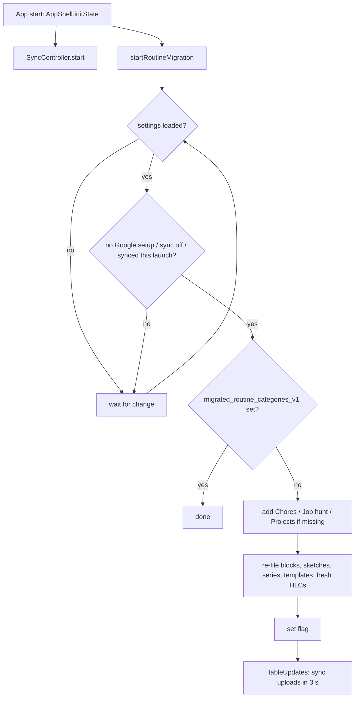

# Routine categories, Library archive, floating nav bar

## What

- **Three new activities** for the daily routine, each with a palette colour the first seven
  left unused: **Chores** 🧹 (`#26A69A` teal), **Job hunt** 📨 (`#E86A92` pink),
  **Projects** 🛠️ (`#AB47BC` purple). New installs seed all ten; existing installs get the
  three from a one-time migration that also re-files the routine:
  - "Home chores" (no activity) → Chores
  - "Job applications" (no activity) → Job hunt
  - "Personal project" (under Fun) → Projects
  - "Meeting" 📞 stays under Work: it was filed there on purpose, and a Meetings activity
    for one entry would add clutter.
  The migration covers saved entries (past and future), sketches, repeats, and templates.
  The routine lives in the "Planned Day" template, with no series, so re-filing the
  template is what keeps future days right.
- **Library › Activities, organising:**
  - Reorder, rename, emoji, colour, pin and delete already existed.
  - New: **archive / restore** (button in the edit sheet) and a folded **Archived (n)**
    section under the list.
  - New: a visible ⠿ drag handle and a one-line hint above the list.
- **Floating nav bar:** the bottom `NavigationBar` and the wide-window `NavigationRail` are
  replaced by an iOS-style pill (`lib/app/floating_nav_bar.dart`).
  - Inset 16 px from the sides and 10 px above the gesture area.
  - Translucent `surfaceContainerHigh` over a 24 σ backdrop blur, with a hairline outline
    so it shows on AMOLED black.
  - Capped at 440 px wide and centred on desktop.
  - Lists scroll underneath it.
- **Small polish:**
  - A selection haptic when switching tabs.
  - Tapping **Today** while already on it returns to today's day dial, like tapping an iOS
    tab twice.
- **Dev harness:** `DONUT_TAB=0..3` starts the screenshot harness on a given tab.

## How

- `lib/data/repos/refile.dart`: pure `RefileRule` / `refiledActivity` /
  `refileTemplateJson`. A rule matches on the label (trimmed, any case) **and** the
  activity the entry has now.
- `LibraryRepo` (`lib/data/repos/library_repo.dart`):
  - `defaultActivities` gains the three; `addedLater` names them.
  - `starterId(name)` = UUIDv5 of the name, used for every starter.
  - `fileRoutineIntoNewCategories()` runs in one transaction, guarded by the `local_kv` key
    `migrated_routine_categories_v1`:
    - Reuses a live activity of the same name; otherwise inserts one with the deterministic
      id, unless a tombstone with that id exists (deleted elsewhere, so don't resurrect it).
    - Re-files saved blocks with fresh HLCs, but skips a block with a pending sketch. The
      sketch's `activityId` changes instead, because the sketch's value is what gets saved.
    - Re-files series and templates with fresh HLCs.
- `lib/features/library/routine_migration.dart`: `startRoutineMigration(ref)`, called from
  `AppShell.initState`. It waits until settings have loaded, then runs when
  `routineMigrationMayRun` allows it: no Google setup, sync off, or a sync that finished
  this launch (`SyncStatus.lastSync != null`). It re-checks on every sync status change, so
  an offline start runs it after the first successful sync.
- `activityMapProvider` now reads a new `allActivitiesProvider` (archived included). Pickers
  still use `activitiesProvider` (archived excluded).
- Shell: `Scaffold(extendBody: true, bottomNavigationBar: FloatingNavBar(...))`.
  - `extendBody` adds the bar's height to `MediaQuery.padding.bottom`.
  - `floatingNavInset(context)` reads that value. Lists with explicit padding add it to
    their bottom padding (agenda, Library tabs, Settings).
  - `aboveFloatingNav` lifts the Library FABs. A nested Scaffold places its FAB from the
    view padding alone, which would leave it under the pill.
  - The Day screen's `SafeArea` no longer pads the bottom, so the agenda scrolls under the
    bar. The dial is sized from the height above the bar, and on wide layouts its padding
    keeps it clear of the bar.
  - Month keeps its `SafeArea`, so its grid stops above the bar.

## Why

- **An in-app migration rather than desktop MCP tools.**
  - The phone is where the plan is made. The desktop app wasn't running, its database was
    two days old, and its Google sign-in couldn't be confirmed.
  - An MCP route would have needed the desktop to be started and signed in, and would
    re-file a stale copy.
  - A migration in the app runs on the phone itself through the repo's HLC-stamping
    writes, then syncs out as usual.
- **Wait for the first sync.** Sync is last-writer-wins per row.
  - A device coming back with stale rows (e.g. the desktop) that re-filed before pulling
    would stamp old content with a new HLC and overwrite newer edits from the phone.
  - Running after a sync means it pulls the already re-filed rows first, finds nothing to
    do, and writes nothing.
  - Matching on the *current* activity, not just the label, keeps the migration idempotent
    and leaves entries the user filed by hand alone.
- **Deterministic starter ids.** Two devices creating "Chores" produce the same row, not two
  rows for `mergeDuplicateActivities` to fold together.
- **The deleted duplicate starters in the desktop DB are not a bug.**
  - Every device seeds its own starters (guarded by the `seeded` flag) with random ids.
  - On first sync, `SyncStore.mergeDuplicateActivities` keeps the smallest id per name and
    tombstones the rest.
  - In all seven pairs, the surviving id is the lexicographically smaller one, which is
    exactly that merge working.
  - The deterministic ids now avoid the churn for new devices.
- **Archive, not just delete.**
  - Deleting an activity strips its name and colour from every entry filed under it.
  - Archiving hides it from pickers but keeps it in `activityMapProvider`, so the dial,
    month view, widget and reminders still show it.
- **One floating bar at every width.** Using the same pill on desktop keeps one navigation
  model. Capping it at 440 px keeps it from stretching across a wide window.
- **Known limits.**
  - A device that syncs but never signs in (sync mode on, no account) never runs the
    migration. That is deliberate, to avoid a later sign-in overwriting newer data.
  - The demo harness can't show light mode while sketches exist, because plan mode turns
    the app night-violet.
