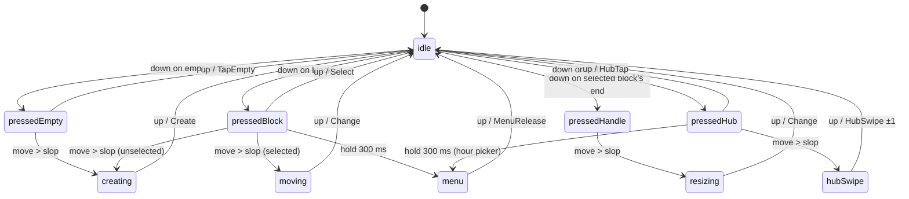

# Clock gesture machine

## What

All touch/mouse input on the dial goes through a pure-Dart state machine
(`lib/features/clock/clock_gesture_machine.dart`) fed by a custom recognizer
(`clock_recognizer.dart`). Every drag draws a new entry (overlaps allowed); only the selected
entry can be moved (drag its body) or resized (drag a handle). Hold an entry for the marking
menu. The hub is a navigation control on both dials: tap = zoom in/out, hold = hour picker,
horizontal flick = next/previous hour (hour dial) or day (day dial). A second finger turns
the gesture into a pinch (zoom). See also overlaps_colours_and_auto_drafts.md.

## How

- The machine owns no timers; `ClockView` runs the 300 ms hold timer and calls
  `holdElapsed()`. That keeps it deterministic, and the tests replay pointer traces.
- Drag value: `snap(clamp(u, lo, hi))`. `u` itself is never clamped, so the block edge never
  drifts from the finger. Overlaps are allowed, so `lo`/`hi` only cap a block at 24 h and,
  on the day dial, to what the overflow lane can show; the hour dial slides instead.
- Presses resolve through `overlap_layout.dart`: minute plus radial position pick the
  sub-lane, so either half of an overlap can be held or tapped.
- Haptics: a selection tick per snap step, one heavy impact when a limit is hit, medium on
  hold.
- `ClockPointerRecognizer` accepts eagerly for presses its `hitTest` claims, so the day
  `PageView` doesn't swipe while you draw. Presses it doesn't claim (outside the rings and hub)
  go to the parent.

## Why

- `Listener` skips the gesture arena, so the page would swipe at the same time as a drag; an
  eager `OneSequenceGestureRecognizer` wins the arena only for ring presses.
- `GestureDetector`'s long-press would fight with drag-to-create; owning the state machine
  gives exact control over slop vs hold.
- The hub is claimed on both dials so holding the date opens the hour picker; a flick across
  it changes day on the day dial, and swiping the header changes day anywhere.
