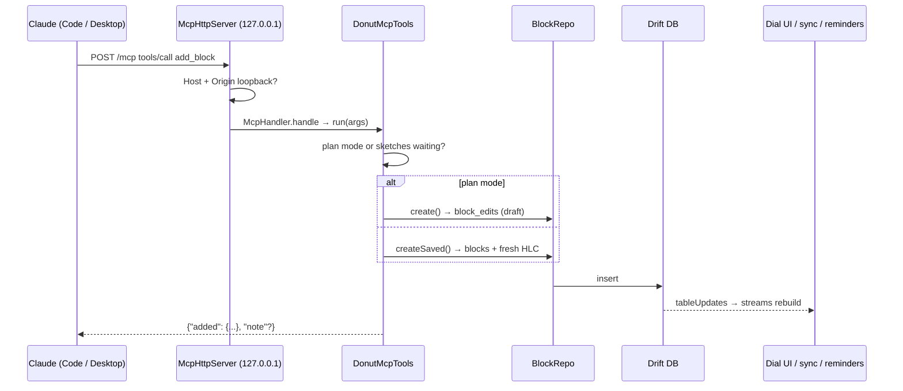

# Desktop MCP server (plan with Claude)

## What

On Linux and Windows, the running app hosts a small MCP server at
`http://127.0.0.1:47821/mcp`, so Claude Code or Claude Desktop (as a local third-party MCP)
can read and plan the day. Tools:

| Tool | Does |
| --- | --- |
| `get_day(date?)` | entries, pins, worked minutes, `plan_mode`, `now` for today |
| `list_blocks(from_date, to_date)` | entries over up to 62 days |
| `add_block(date, start, end \| duration_minutes, label?, activity?, emoji?, color?, sketch?)` | new entry; end ≤ start runs past midnight |
| `update_block(id, date?, start?, end?, duration_minutes?, label?, activity?, emoji?, color?)` | move / resize / relabel; `""` clears |
| `delete_block(id)` | removes an entry |
| `find_free_slots(date?, min_duration_minutes?, from?, to?)` | gaps; today starts at now |
| `list_activities()` | Library activities by name, emoji, colour |
| `add_pin(date, time, kind, label?)` / `delete_pin(id)` | pins (Reach by / Meeting at / Leave by / custom) |

Settings › Claude (desktop only) has an on/off switch (default on), the port, and a
copy button for `claude mcp add --transport http donut http://127.0.0.1:47821/mcp`.

## How

- `lib/features/mcp/mcp_tools.dart`: `DonutMcpTools` — plain Dart over `BlockRepo`,
  `PinRepo`, `LibraryRepo`, `WorkRepo`, plus a `planModeOn` callback. Parses `YYYY-MM-DD` /
  `HH:MM` into floating absolute minutes (`Day.startMin + h*60 + m`), validates, and
  returns JSON. Bad input is an `McpToolError`, sent back as a tool result with `isError`
  so the model can correct itself.
- `lib/features/mcp/mcp_server.dart`:
  - `McpHandler` — JSON-RPC 2.0: `initialize` (echoes a supported `protocolVersion`),
    `ping`, `tools/list`, `tools/call`, notifications (no reply), batches.
  - `McpHttpServer` — `dart:io` `HttpServer` bound to `127.0.0.1` (and `::1` on the same
    port when available). `POST /mcp` → JSON; notifications → 202; GET/DELETE → 405.
- `lib/features/mcp/mcp_provider.dart`: `mcpServerProvider` (a `Notifier`) starts the server
  once settings have loaded, watches only `(mcpServer, mcpPort)`, closes it on rebuild or
  dispose, and reports "port in use" instead of crashing. `DonutApp` keeps it alive with
  `ref.listen`, so it runs from launch, even during onboarding.
- Repo additions: `BlockRepo.find(id)` (effective block, edit applied), `createSaved(emoji:)`,
  `PlanBlock.copyWith(color:)`, `PinRepo.find(id)`, `settingsLoadedProvider`, and the
  `mcpServer` / `mcpPort` settings.

## Why

- **Same write paths as the dial.** The tools follow `DayPage` in `day_screen.dart`: in plan
  mode (switched on, or any sketch waiting) or for an entry that is already a sketch, edits go
  to the draft overlay; otherwise they save instantly through `createSaved` / `updateSaved` /
  `deleteSaved`, which stamp the HLC. Sync (debounced on `tableUpdates`), reminders and the
  UI all react to the DB, so nothing MCP-specific is needed downstream. A new entry's colour
  comes from `pickEntryColor` exactly as `_colorFor` does. `sketch: true` lets Claude propose
  entries for the user to ✓ even outside plan mode (this also turns the app night-violet).
- **Localhost only.** The org plan allows only local third-party MCP, and the planner is
  personal data. Binding loopback keeps it off the LAN; the `Host` check plus refusing any
  non-loopback `Origin` stops DNS-rebinding from a web page (MCP spec's transport security).
  No auth token: anything local could already read the SQLite file.
- **Hand-rolled JSON-RPC.** No Dart MCP package was available, and `json_rpc_2` is built on
  stream channels, not one-request-one-response HTTP. A stateless server with plain JSON
  responses (no SSE, no `Mcp-Session-Id`) is all four methods need, ~200 lines, no new deps.
- **Floating times.** Inputs and outputs are local wall-clock `HH:MM`, matching block storage
  (see floating_time_and_storage.md); an entry crossing midnight reports `end_date`.
- **Settings are synced.** `mcpServer` / `mcpPort` live in the synced `settings` table like
  every preference, so toggling on one desktop toggles the others; phones ignore them. A
  per-device `local_kv` flag was the alternative, but it would need its own UI plumbing for
  little gain.
- **Testing without the real DB.** `DONUT_DEMO=1` opens an in-memory database, so the built app
  can be exercised with curl without touching the user's plan or syncing anything.
