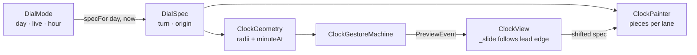
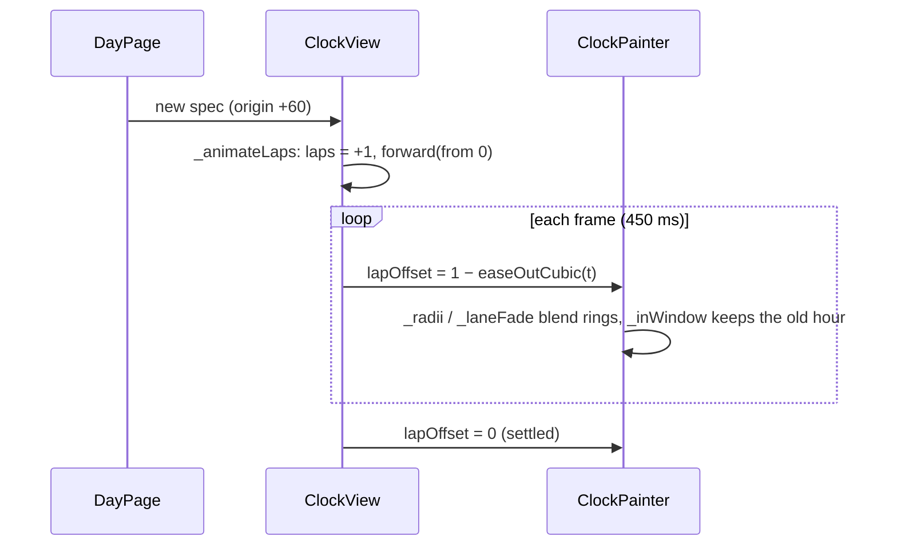

# One dial engine for the day dial and the hour dial

## What

The planner clock has two zoom levels drawn by the same code:

- **Day dial** — two 12-hour laps: inner ring AM, outer ring PM. 15-minute snap by default.
- **Hour dial** — two 60-minute laps. The inner ring is the active hour, the outer ring the
  hour after. 5-minute snap by default. Dragging off either end slides both rings by an hour.
  Kept deliberately quiet: only the 00/15/30/45 numerals, a tick every five minutes, no ring
  captions, and a hub that shows just "NOW" + the time (or the hour).
  - **Every hour, live or browsed, is a fixed clock hour**: inner 16:00 → 17:00, outer
    17:00 → 18:00. In the live hour the part already gone is dimmed and the hub shows the
    current time.
  - The outer ring is a **preview of the next hour**: its entries are drawn at half strength
    and a small tag ("5 PM") names it.

A position on the dial always means the same clock reading (on the hour dial the "2" is
always :10). Which ring it is on decides *which* :10.

## How

`lib/features/clock/spiral_math.dart` → `DialSpec { turn, origin, slides }`:

- `turn`: minutes per lap (720 or 60).
- `origin`: day-relative minute where the inner lap begins (0, an hour boundary, or "now").
- `angleOf(u)` is always `u mod turn` — the clock position.
- `lapOf(u) = floor((u - origin) / turn)` → 0 inner, 1 outer, else overflow lane.
- `minuteAt(angle, lap)` is the inverse used on press.
- `pieces(start, end)` cuts an interval where it changes lane (origin, origin+turn, end) so the
  painter draws one arc per lane; overflow is capped at one turn, keeping the part nearest
  the rings.

`SpiralTracker` keeps one unbounded minute `u` and adds wrapped angle deltas scaled by
`turn`, so crossing the seam, running into the next hour or day, and dragging backwards
need no special cases. Everything downstream (gesture machine, painter, geometry) takes a
`DialSpec` instead of assuming 720.

The page decides the spec from `DialMode` (`lib/features/day/dial_mode.dart`):
`day` / `live` / `hour(absStart)`. `specFor(day, now)` keeps the same hour-of-day when you
swipe to another day's page. `ClockView` keeps a private `_slide` (laps slid during a drag)
and resets it only on a real hour or level change — the live origin creeps forward every
minute and must not reset it mid-drag.

## Why

- The user first asked for an AM/PM day clock, then for hour-level planning ("it's 12:35,
  active hour is 12; past the top is the next hour") for things like 4:05 get ready → 4:10
  home to station → 4:15–4:55 train. At 720 minutes per turn a fingertip covers ~45 minutes;
  at 60 per turn it covers ~4, so 5-minute snapping is comfortable.
- Planning a whole day an hour at a time is slow, so the day dial stays as the zoomed-out
  level (tap an hour or pinch to zoom in; tap the hub or pinch out to zoom back).
- The user first chose (via the design-questions page) a *rolling* live hour (inner lap
  starting at the minute hand), two rings for overflow, zoom for navigation, 5-minute snap,
  and drawing in the past (dimmed). In use, rolling split entries at the hand (a 5–6 PM
  entry straddled both rings at 4:25) and made the live 4 PM look different from browsed
  4 PM, so the live hour became the fixed clock hour. `DialSpec` still supports an
  arbitrary origin, which is why the seam/rolling tests remain.
- A single parameterised spec meant the existing gesture machine, drafts, menu and data
  model carried over unchanged; only the mapping between minutes and the dial moved.
- Alternatives considered: a true spiral (one band, thinner lanes, harder to read) and
  stacked laps (hides what is already in the next hour). Both rejected by the user.
- Blocks wholly outside the two visible laps are not drawn at all; only blocks that cross
  the window's edges spill over, otherwise the bands fill with unrelated hours.
- Spill is drawn like a spiral: time *before* the inner lap goes on a thin band **inside**
  the inner ring (`Lane.before`), time *after* the outer lap on a thin band **outside** the
  outer ring (`Lane.after`). The user asked for the past spill (e.g. the 2:55–3:00 part of
  a 2:55–3:05 entry seen from 3 PM) to sit inside rather than on the outer band.

## Hour glide and constant bands

### What

- When the hour dial moves forward by one hour (a slide during a drag, a flick on the hub,
  the clock ticking over), entries **glide inward**: the next-hour ring's entries shrink onto
  the inner ring, and the old hour's entries slide onto the thin inside band and fade.
  Moving back an hour plays the same glide outward. Jumps of more than one hour just switch.
- The two thin spill bands (inside and outside) are **always drawn** as faint tracks, not
  only when something spills onto them. The user reported the inside band as "not
  consistent" because it appeared and disappeared with the entries.

### How

- `ClockView` owns `_laps`, a 450 ms `AnimationController` (`easeOutCubic`).
  `_animateLaps(from, to)` starts it only when both specs are hour dials and the origin moved
  by exactly ±1 turn. It is called from `didUpdateWidget` (a new spec from the page) and
  from the drag slide.
- The painter takes `lapOffset`, which runs from ±1 to 0:
  - `_radii(lane)` blends each lane's radii towards the neighbouring ring
    (before ↔ inner ↔ outer ↔ after).
  - `_laneFade(lane)` blends opacity the same way (bands 0.55, inner 1.0, the hour dial's
    outer ring 0.5).
  - `_inWindow` widens to the hour leaving the rings so its entries can glide away rather
    than vanish. Entries outside the final window fade out with `|lapOffset|`.

### Why

- Time flows from the outer ring to the inner ring and then to the inside band, so the
  animation shows the same direction. The user asked for an "inward animation" after
  the switch to fixed clock hours made rings jump without visual continuity.
- Interpolating radii in the painter keeps the gesture machine and geometry untouched: hit
  testing uses the final spec, and the animation is short enough that a touch during it
  lands on the settled layout.
