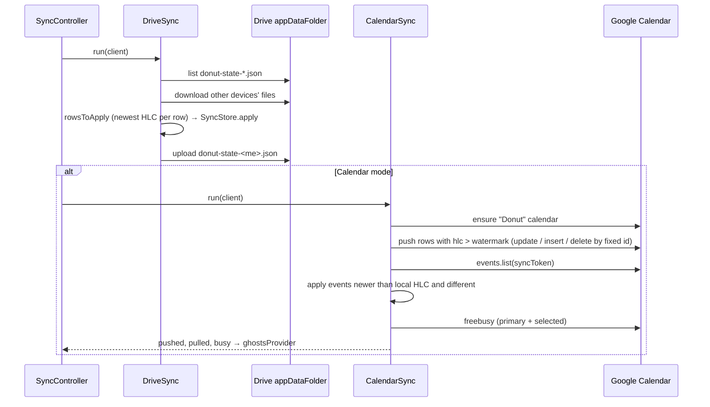

# Google sync: Drive device sync and the Donut calendar

## What

Settings → Sync offers three modes:

- **Off:** everything stays on the device.
- **Devices:** entries, pins, tasks, to-dos, templates, repeats and shared settings sync between
  devices through Drive's hidden app folder (`drive.appdata`).
- **Calendar:** device sync, plus:
  - Saved entries are mirrored two-way to a dedicated "Donut" Google calendar.
  - Busy times from your other calendars are drawn as faint **ghost arcs** on the dial.
    Only free/busy is read, never what the events are.

Sketches (plan mode) never sync; only `blocks` does, and sketches live in `block_edits`.
Setup, which needs the user's own OAuth clients, is in `docs/google-setup.md`.

## How

- **Auth** (`lib/features/sync/google_auth.dart`): one `GoogleAuth` interface with two
  implementations.
  - **Android:** `google_sign_in` 7 (Credential Manager) with the Web client id as
    `serverClientId`. Scopes are authorised separately (`authorizeScopes` /
    `authorizationForScopes`) and turned into an `http.Client` by
    `extension_google_sign_in_as_googleapis_auth`.
  - **Desktop:** `googleapis_auth` `obtainAccessCredentialsViaUserConsent`, which opens the
    browser and uses a loopback redirect. The refresh token is kept in
    `flutter_secure_storage` (libsecret), with a chmod-600 file as fallback.
    `autoRefreshingClient` saves refreshed credentials.
  - Client ids come from `--dart-define-from-file=google.json`. Without them the settings
    section shows a "not set up" card and sync never starts.
- **Device sync** (`merge.dart`, `sync_store.dart`, `drive_sync.dart`):
  - Every synced row carries an HLC, and deletions are tombstone rows (`deleted: true`).
  - `SyncStore.snapshot` dumps the synced tables as JSON via Drift's `toJson`.
  - `DriveSync.run` lists the whole app folder (no `q`: Drive's `name contains` is a
    word-prefix search over an index that lags for new files) and downloads every *other*
    device's `donut-state-<device>.json` whose `version` changed since the last merge
    (`DriveSyncMemo`). `rowsToApply` picks, per row, the copy with the newest HLC, and only
    rows newer than the local copy are written.
  - It uploads this device's own file only when its newest HLC moved since the last upload,
    so a quiet poll is a single list call. The local HLC clock is advanced past anything
    received.
  - After applying remote tasks, `SyncStore.mergeDuplicateActivities` folds same-named
    tasks into one. Each device seeds its own starter tasks with random ids, so two
    devices meeting would otherwise show "Study" twice. The kept id is the smallest, so
    every device picks the same one. It takes the fields of the most recently edited copy.
    Entries, to-dos, repeats, templates and sketches pointing at the others are moved over
    with fresh HLCs. Starter tasks are stamped `000…-seed`, older than any real edit.
  - `deviceSettings` (sync mode, reminders on/off, theme, AMOLED, dynamic colour, seed)
    never leave or enter a device.
- **Calendar mirror** (`calendar_sync.dart`):
  - `_ensureCalendar`: stored id → find "Donut" among owned calendars → create.
  - `_push`: entries whose HLC is past the `gcal_pushed_hlc` watermark.
    - Each becomes `events.update` with a **deterministic event id** (UUID without dashes;
      other ids hex-encoded; `gcal-<id>` maps back to `<id>`). On a 404 it falls back to
      `insert`.
    - Deletions become `events.delete`; a 404 or 410 counts as done.
    - Our fields ride in `extendedProperties.private` (`donutId`, colour, activity, note).
    - Google reminders are off (`useDefault: false`).
  - `_pull`: incremental `events.list` with the stored `syncToken`. On a 410 it re-lists
    everything and matches by id (never wipes).
    - An event replaces the local entry only if Google's `updated` is later than the
      entry's HLC time **and** its content differs, so our own pushes don't echo back as
      edits.
    - Events created in Google become entries titled with the event's name
      (`gcal-<eventId>`). All-day events are skipped.
  - `_busy`: `freebusy.query` for primary plus the calendars selected in Google Calendar,
    today and tomorrow. The result is cached in `LocalKv` so the arcs appear offline.
- **Controller** (`sync_controller.dart`):
  - Restores sign-in at start.
  - Syncs at start, on resume, 3 s after the last local change to a synced table, and
    every 30 s while the app is in the foreground (paused when hidden or in the
    background). Busy times are refetched at most every 10 minutes.
  - Only one sync runs at a time (`busy`).
  - Errors become a one-line status (offline / Google error / "allow access again").

## Why

- **One file per device.** Drive has no conditional writes. With one shared file, two
  devices writing at once would silently lose one device's changes. With per-device
  files each device only overwrites its own, and last-writer-wins by HLC is commutative,
  associative and idempotent, so the order of reads doesn't matter (property-tested in
  `test/sync/merge_test.dart`). The cost is downloading N small files per sync, which is
  fine for a personal app.
- **`drive.appdata` + `calendar.app.created`** are the narrowest scopes that work: Donut can
  see only its own hidden folder and only the calendar it created. Free/busy uses
  `calendar.events.freebusy` + `calendarlist.readonly` rather than read access to events.
- **Deterministic event ids** make every push idempotent: a retry after a timeout updates
  rather than duplicates, and a reinstall finds the same events. Entries that came from
  Google keep their event's id for the same reason. An earlier version re-encoded
  `gcal-<id>` and inserted a copy on the first push back.
- **Polling every 30 s.** Drive offers push notifications only to a public webhook, which a
  personal app doesn't have. The first version polled every 10 minutes and re-downloaded
  and re-uploaded everything each time; in use, a delete on the phone took up to 10 minutes
  to reach the desktop, which felt broken. Memoising file versions and the last uploaded
  HLC made frequent polls cheap enough.
- **Per-device settings.** Grants are per device. If the laptop switching to Calendar mode
  synced to a phone that only granted Drive access, every sync on the phone would fail
  until it re-consented. Reminder permission and screen preferences (AMOLED) are
  per device too.
- **Simplifications versus the original plan**, revisit if they bite:
  - No `If-Match`/412 on pushes and no keep-mine / keep-theirs prompt. A clash between an
    edit in Google and one in Donut resolves by timestamp.
  - Tombstones never expire.
  - Renaming a Donut-made event in Google Calendar doesn't rename the entry (the title is
    derived from the label/task). Moving, resizing or deleting it does come back.
  - Recurring series sync as their generated instances, so no Google RRULEs.
- Desktop consent needs the OAuth app to be **In production** (unverified is fine for
  personal use). In Testing, Google expires refresh tokens after 7 days.

**Not yet verified live:** everything compiles on Android and Linux and the merge/mapping
logic is unit-tested, but no sign-in has run against real OAuth clients yet.
