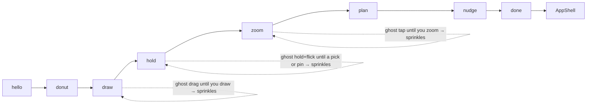

# First-run tour

## What

On a device's first launch, a short tour runs before the app. **The dial is the star**,
not a mascot.

- **Showcase:** on hello and done, a sample day draws itself around the dial.
- **Practice:** draw, hold and zoom happen on a real practice dial. A translucent **ghost
  finger** loops the gesture: a drag along the ring that leaves a trail, a press with a
  ripple and then an upward flick, or a tap. It disappears once you've done the gesture
  yourself.
- **Celebration:** success bursts **sprinkles** out of the dial in the entries' palette,
  the dial gives a small bounce, and the words change to praise.
- **Steps:** hello → your day as a donut → draw → hold (tasks, labels, pins) → zoom →
  plan mode (a preview of the violet sketchpad) → reminders (opt-in, with sample
  notifications) → done.
- **Look:** the app's own Material You colours and pill buttons; progress is a small
  donut that fills step by step ("3 of 8"), with sprinkles drifting faintly behind.
- **Skipping:** "Skip this step" on practice steps, "Skip tour" at the top, and
  Settings → About → **Replay the tour** to see it again.

## How

- **`lib/features/onboarding/playful.dart`:**
  - `StepRing`: progress donut.
  - `SprinkleBurst`: closed-form particles (`origin + dir·speed·ease(t)` plus a little
    fall), so no particle state is stepped.
  - `DriftingSprinkles`: background.
  - `GhostFinger`: a looping gesture demo laid over the dial with the same
    `ClockGeometry`, so it lands exactly on the rings.
- **`onboarding_screen.dart`:**
  - The steps, and the practice dial's callbacks (create, move, hold menu, empty-spot
    pins, zoom) on throwaway local state.
  - The showcase animation (`_sampleBlocks(progress)`).
  - The `onboarded` state.
- **First-run flag:** `OnboardedNotifier` keeps `onboarded` in LocalKv (per device,
  never synced). `main` reads it into `onboardedAtStartProvider`. `DonutApp`'s `_Home`
  cross-fades from the tour to `AppShell`, which only then starts sync, reminders and the
  widget bridge.
- **Dev harness:** `DONUT_ONBOARD=<step>` opens the tour at a step
  (`onboardingFirstStepProvider`); otherwise the harness skips it.

## Why

- The user found the app "a bit confusing at first" and wanted something welcoming and
  playful, "like Duolingo".
- **First version, rejected:** a talking donut mascot in speech bubbles, Duolingo's
  green, chunky 3D buttons and a thick progress bar. The user said it was a one-to-one
  copy: they wanted the spirit, not the look.
- **Second version:** draws the playfulness from Donut itself. The dial animates, the
  progress is a donut, the confetti is sprinkles, and the colours are the user's theme.
- **Ghost finger, not text:** the dial's gestures (drag, hold and flick, tap to zoom)
  are invisible until tried, so the tour shows each one moving on the real dial and asks
  you to do it.
- **Practice state is local**, so nothing drawn in the tour lands in the plan or syncs.
- **The flag is per device**, so a new phone gets the tour even when its plan arrives
  through sync.
