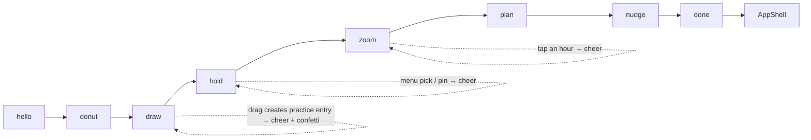

# First-run tour with Sprinkles

## What

On a device's first launch, a playful tour runs before the app, hosted by Sprinkles, a
hand-drawn donut mascot that bobs, blinks and jumps for joy.

- **Steps:** hello → your day is a donut (sample dial) → draw your first entry → hold it
  (Tasks up, Label down, pins left/right) → zoom into an hour → plan mode → nudges
  (opt-in reminders) → done.
- **Learning by doing.** The draw, hold and zoom steps use a real `ClockView` on
  throwaway local state. The main button stays grey until you've done the thing; then
  Sprinkles cheers, confetti bursts and the button lights up. "I'll try later" skips
  any step, and ✕ skips the whole tour.
- **Look:** a thick green progress bar, chunky 3D buttons that press into their ledge,
  and speech bubbles that type themselves out.
- **Replaying:** Settings → About → **Replay the tour**.

## How

- `lib/features/onboarding/`:
  - `sprinkles.dart`: mascot painter (dough with the hole punched out, wobbly frosting,
    sprinkles, face on the lower half) and its animations: bob, random blinks, a jump
    with squash and wiggle whenever `cheer` changes.
  - `playful.dart`: `ChunkyButton`, `SpeechBubble`, `ProgressPill`, `ConfettiBurst`.
    - The bubble's typewriter keeps its layout fixed by drawing the unrevealed
      characters transparent.
    - Confetti positions are closed-form (`origin + v·t + g·t²`), so no particle state
      is stepped.
  - `onboarding_screen.dart`: the steps, the practice dial's callbacks (create, move,
    hold menu, empty-spot pins, zoom), and the "onboarded" state.
- **First-run flag:** `OnboardedNotifier` keeps `onboarded` in LocalKv, which is per
  device and never synced. `main` reads it and overrides `onboardedAtStartProvider`.
  `DonutApp`'s `_Home` cross-fades from the tour to `AppShell` on finish. The shell (and
  with it sync, reminders and the widget bridge) starts only after the tour.
- **Nudge step:** "Yes" turns reminders on in settings and asks for notification
  permission.
- **Dev harness:** `DONUT_ONBOARD=<step>` opens the tour at that step
  (`onboardingFirstStepProvider`). Without it the harness skips the tour.

## Why

- The user found the app "a bit confusing at first" and asked for a welcoming,
  Duolingo-like, playful guide. The dial's gestures (drag, hold and flick, tap to zoom,
  hold the centre) are invisible until tried, so the tour has you do each one on a
  practice dial instead of reading slides.
- **Practice state is local**, so nothing the user draws in the tour lands in their plan
  or syncs.
- **The flag is per device**, so a new phone gets the tour even when its plan arrives
  through sync. Existing installs see it once after updating, which is intended (that is
  how the user meets it).
- **Dark button text on the green:** white on #58CC02 is below accessible contrast, so
  `ChunkyButton` picks its ink from the colour's brightness.
