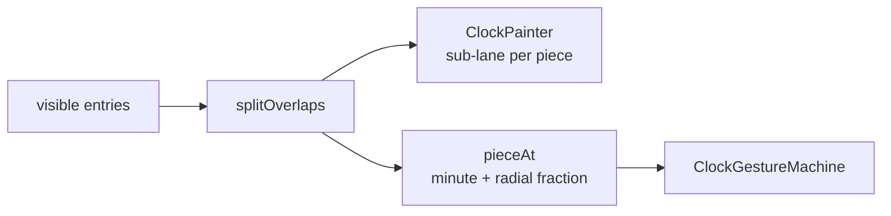

# Overlapping entries, per-entry colours and auto-drafts

## What

Feedback from testing on a phone-sized screen:

- **Every drag draws a new entry.** That holds even when the drag starts on, or runs across,
  an existing entry. Moving and resizing only apply to the *selected* entry, so tap first.
- **New entries aren't auto-selected.** That way the next drag can't grab the previous
  entry's handle by accident.
- **Overlaps are allowed.** Entries that overlap share the ring's width in columns, like
  clashing events in a calendar. While it overlaps others an entry keeps **one column**
  (widened into neighbouring columns that are free for its whole length); wherever it is
  alone it uses the full width. Each entry is drawn as one continuous outline
  (`ClockPainter._runPath`).
- **Each entry gets its own colour** from `entryPalette`, chosen to differ from the entries
  it touches or overlaps. Older entries without a stored colour get a stable hash colour.
- **Edits save instantly** outside plan mode; plan mode (pen icon) turns them into sketches
  until ✓ / ✕ (see edit_overlay_drafts.md). Superseded an interim "every edit is a draft"
  version.
- **No "Untitled".** An entry without a label or task is titled by its times.
- **The menu is Tasks | Label.** The emoji section is gone (activity emojis still show).
- **Entries in the agenda can be swiped left to reveal Delete** (`flutter_slidable`).

## How

- `lib/features/clock/overlap_layout.dart`:
  - `splitOverlaps(spans)` groups chained overlaps into clusters. Each block takes the
    first column free at its start (earlier start, then longer, then id), and `span` widens
    it over the next columns while none of their blocks overlaps it. The cluster's column
    count is its peak concurrency.
  - Each block's pieces are its shared stretches (that column) and its alone stretches
    (`0+1/1`, full width).
  - `pieceAt(pieces, u, fraction)` hit-tests by minute *and* radial position (within
    `index..index+span`).
  - The painter and the gesture machine both use it, so a press on the outer half of an
    overlap picks the entry drawn there.
- `clock_gesture_machine.dart`:
  - `_PressedBlock` + move → `_startCreate` unless the block is selected (then `_startMove`).
  - Neighbour clamping is gone; only the visible-lane caps (day dial) and the 24 h cap remain.
- Schema v2 adds a nullable `color` to `blocks` and `block_edits` (`onUpgrade` →
  `addColumn`). `BlockRepo.create(color:)`; every overlay write uses `EditState.draft`.
- `DayPage._colorFor` cycles the palette from the day's entry count, skipping colours
  already used by touching or overlapping entries. Colour precedence:
  entry colour → activity colour → `fallbackEntryColor(id)`.

## Why

- The user wanted drawing to feel like sketching: "click and drag, draft saved, click and drag
  a new entry". The previous model (drag on a block = move it, auto-select new blocks,
  "Unsaved" vs "Draft") put edit gestures where new drawing was expected.
- Same-colour back-to-back entries (all unlabelled, or all the same task) were unreadable.
  So the entry's own colour wins over its activity's.
- Overlaps split radially rather than stacking or blocking, so both entries stay visible
  and tappable.
- **First version:** each time slice re-split its active entries evenly, which moved an
  entry's sub-lane whenever the overlaps around it changed. On the phone, red and purple
  sketches zig-zagged across three positions ("keep connected splits connected").
- **Pure calendar columns** fixed that but made a long entry chained to many overlaps a
  thin line along its whole length ("hard to manage").
- **The hybrid:** a fixed column while sharing, full width while alone. The only steps
  left are between alone and shared, on one side of the band.
- **The remaining limit:** N entries overlapping at once each get 1/N of the ring.

## Recolouring older entries

- Entries made before colours were stored had no `color` and fell back to an id hash,
  so neighbours often clashed. At startup `main.dart` runs
  `BlockRepo.assignMissingColors()`. In one transaction it gives each uncoloured saved
  entry and sketch a palette colour via `pickEntryColor`, avoiding the colours of entries it
  touches or overlaps. Once every entry has a colour, it does nothing.
- `pickEntryColor` (`lib/core/entry_colors.dart`) is shared with `DayPage._colorFor`, so new
  and recoloured entries follow the same rule. Recoloured saved entries get a fresh HLC, so
  the new colour syncs.
