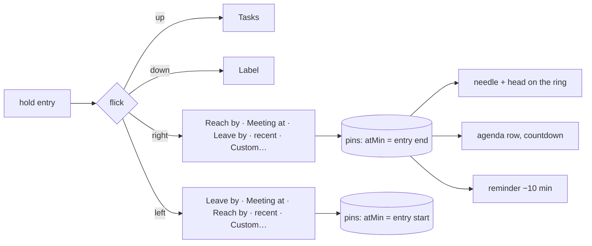

# Pins: "Reach by", "Meeting at", "Leave by"

## What

A pin marks a moment rather than a span: "Reach by 4:55", "Meeting at 5:00", "Leave by
3:50", or custom text ("train leaves").

- **Making one:** hold an entry and flick **sideways**. The pin goes at the moment you're
  holding, or at the entry's start or end when held within a few minutes of it (so
  "Reach by" the end of a train needs no aim). The list's rows show the time ("🏁 Reach by
  12:30"). Left lists Leave by first and right lists Reach by first, so a straight flick
  and release is enough. Next come the other kinds, up to three recent custom texts, and
  *Custom…*.
- **On an empty spot:** hold an empty part of either ring (or right-click it) and the same
  list opens at that moment, snapped to the dial's step. It stacks upward from the finger
  so the hand doesn't cover it (downward without room above). Reach by comes first; a
  📍 marks the spot on the ring and the bubble reads "Reach by 5:20 PM" as you slide.
  Moving before the hold time still draws an entry.
- **On the dial:** a needle across the ring with a round head carrying the kind's glyph.
- **In the hub and agenda:** the live hour's hub counts down to the next pin within 3 h
  ("🏁 Reach by · 14m"). The agenda lists pins among the entries by time (a pin before an
  entry starting at the same minute), with swipe to delete and Edit time.
- **Reminders and plan mode:** each pin notifies 10 minutes early, whatever the entries'
  lead time. Pins dropped in plan mode are sketches until ✓ (✕ discards them, with Undo).

## How

- **Storage:** `Pins` table (schema v3, `createTable` on upgrade):
  - `atMin` is a floating local minute, like blocks.
  - `kind` is a `PinKind` name; `label` holds the text of custom pins.
  - `draft`, `hlc` and `deleted` (tombstones) work as for other synced tables.
- **`PinRepo`** (`lib/data/repos/pin_repo.dart`):
  - `create`, `move`, `delete` (a sketch is hard-deleted, a saved pin tombstoned), and
    `restore` for Undo.
  - `commitDrafts` / `discardDrafts` for ✓ / ✕. `DayScreen._savePlan` / `_discardPlan`
    call them alongside the entry overlay.
  - `watchDraftCount` feeds `draftCountProvider`, so a sketched pin alone keeps plan mode
    open.
- **Menu:** the hold menu's split root has four items, clockwise from the top: Tasks, pin,
  Label, pin.
  - `MenuOpenEvent` carries the held minute `u`, and `ClockView.menuItems(blockId, u)`
    passes it on.
  - `pinSpotInEntry` (`pin_repo.dart`) places the pin. The edge zone is the larger of the
    snap step and a tenth of the entry, at most 10 minutes; held further in, the time is
    snapped to the step.
  - The minute is encoded in the item ids (`pin:<minute>:<kind>`). The pin items carry `asList: true`, so their kinds open as a list
  (see `marking_menu_and_hour_picker.md`). Releasing on a pin item without choosing a row
  takes its default kind (the item's id is that kind). `DayPage._pin` reads the entry's
  start or end time and asks for text for *Custom…*.
- **Empty-spot hold:** `ClockGestureMachine` arms the hold timer for `_PressedEmpty` too.
  On expiry (or a secondary click) it emits `EmptyHoldEvent(snapped u)`. `ClockView`
  opens a `MarkingMenuController(listRoot: true, title: time)` from `pinMenuItems`, draws
  a preview pin at `u` while it's open, and reports the release through `onPinPick`.
  `DayPage` builds both pin lists with `_pinItems(side, kinds)` and makes the pin with
  `_pin(atMin, what:)`.
- **Painting:** `ClockPainter._pins` draws pins after the entries and before the past
  scrim, so past pins dim. Like entries, only pins on the two rings show. A pin exactly at
  the outer ring's end (an entry ending on the hour) is drawn at its 12 o'clock rather than
  dropped. Pins glide and fade with the hour animation.
- **Sync and reminders:** pins sync through Drive like other tables; `SyncStore.snapshot`
  leaves out drafts. `planReminders(pins:)` adds one reminder per saved pin, `pinLeadMin`
  (10) minutes early.

## Why

- Holding an empty spot was added when the user asked for the pin list there too
  ("empty space pe toh bhi aana chahiye"), for a moment not tied to an entry. The hold
  uses the same 300 ms as entries; drawing starts with movement, so a quick drag still
  draws.
- The user asked for pins "for reach by, meeting at, etc" on hold + left/right.
  - **First version:** left pinned the entry's start and right its end. Then the user
    wanted a pin in the middle of a long entry (a meeting inside "Work 10:00–12:30"),
    which that couldn't do.
  - **Now:** they chose "where I held", with snapping near the edges so start and end pins
    stay effortless.
- **A separate table, not zero-length entries.** Entries assume a span (overlap lanes,
  handles, the edit overlay, calendar events). Pins are independent of the entry they were
  dropped on, so re-planning entries around a deadline doesn't move the deadline.
- **No edit overlay for pins.** A `draft` flag is enough. Deleting a saved pin in plan mode
  is immediate (with Undo) instead of a sketched delete; that's simpler, and pins are
  cheap to re-drop.
- **Not yet:** pins aren't mirrored to Google Calendar, aren't drawn on the home-screen
  widget, aren't copied by templates or "copy yesterday", and can't be dragged on the
  dial (Edit time in the agenda instead).
