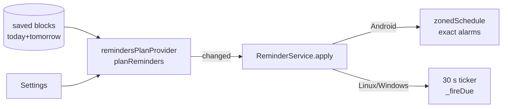

# Reminders per platform

## What

A notification when a saved entry starts, optionally a few minutes early (Settings →
Reminders, lead time). Sketches in plan mode never remind. Android schedules them with the
system so they fire while the app is closed. Linux (and later Windows) fires them from
inside the running app.

## How

- `lib/features/reminders/reminder_service.dart`:
  - `planReminders(saved, activities, nowMin, leadMin, use24h, horizonMin = 2880)` is a pure
    function. It turns saved entries starting within the next 48 h into `Reminder`s with
    stable 31-bit ids (FNV hash of the entry id). It is unit-tested in
    `test/reminders/plan_reminders_test.dart`.
  - `ReminderService.apply(reminders)` replaces the whole schedule:
    - **Android:** `cancelAll` + `zonedSchedule(exactAllowWhileIdle)` per reminder.
      `timezone` + `flutter_timezone` provide the local zone.
    - **Desktop:** keeps the list and checks it every 30 s. `_fireDue` shows anything
      whose time fell between the previous check and now, comparing wall-clock minutes,
      so a laptop waking from suspend still fires what it missed during the last interval.
- `lib/features/reminders/reminder_providers.dart`:
  - `remindersPlanProvider` recomputes from saved entries (today + tomorrow), activities
    and settings.
  - `startReminders` (called from the app shell) re-applies the schedule only when the
    list actually changes, not every minute.
- Android setup:
  - Permissions: `POST_NOTIFICATIONS` (asked for when you turn reminders on),
    `USE_EXACT_ALARM` (allowed for a sideloaded calendar-like app, no user prompt) and
    `RECEIVE_BOOT_COMPLETED`, plus the plugin's boot and schedule receivers, so alarms come
    back after a reboot.
  - Core library desugaring is enabled in `build.gradle.kts`.
  - The status-bar icon is `ic_stat_donut`.

## Why

- Re-planning the whole 48 h window on every change avoids tracking individual alarms:
  `cancelAll` + reschedule is cheap for a day's worth of entries, and stable ids mean a
  notification already showing is replaced rather than duplicated.
- The 48 h horizon fits Android's alarm limits. If the app isn't opened for two days,
  reminders run out. This is acceptable for a planner you open daily; the widget update
  doesn't re-arm them.
- Linux has no system scheduler that `flutter_local_notifications` can use, so the app does
  it. The original plan had close-to-tray (`tray_manager`) to keep it running; that is not
  built yet, so Linux reminders fire only while the window is open.
- Google Calendar's own reminders are switched off on mirrored events
  (`useDefault: false`) so you aren't notified twice.

**Two release-only bugs, found on the phone** (reminders had never worked there):

- **Icon shrunk away.** Resource shrinking removed `ic_stat_donut`, which only Dart refers
  to by name. `initialize` threw `invalid_icon`, so nothing was scheduled and the
  permission prompt (requested after it) never showed. `res/raw/keep.xml` keeps the
  drawable, and `startReminders` now asks for permission before setting up.
- **Timezone names.** The phone reports the legacy name `Asia/Calcutta`, which
  `timezone`'s default data lacks, so reminders fell back to UTC (5½ h off). It now loads
  `latest_all` (links included) and, failing a lookup, uses any zone at the current
  offset.

Settings shows "Notifications are blocked" with **Allow** when reminders are on but the
system says no. If Android has stopped showing the prompt (after two refusals), Allow
opens Donut's notification settings through a `donut/system` channel in `MainActivity`.
The check reruns whenever the app resumes.

Verified on the phone (2026-10-19): the prompt shows, and exact alarms are scheduled at
the right local times.
