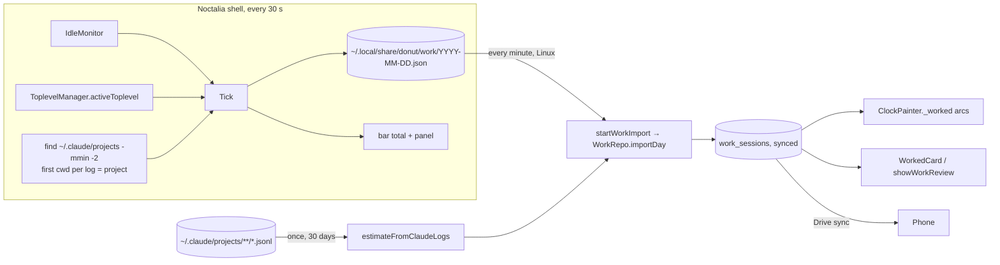

# Work tracker: Donut Work (Noctalia) + worked time in Donut

## What

The desktop measures working time by itself; Donut shows it next to the plan.

- **Noctalia plugin "Donut Work"** (`linux/noctalia/donut-work/`, symlinked into
  `~/.config/noctalia/plugins/`), on the right of the bar.
  - **The bar:** today's total ("⏱ 3h 12m"), bright while counting. Left click opens the
    panel; right click toggles a manual session or opens Donut.
  - **The panel:** work total with personal time beside it, what's counting now and
    why, and Start/Stop.
  - **Every project is a chip**; click it to switch between work and personal, and the
    whole day recounts at once.
  - **Work sessions** show their work projects and any personal ones that ran
    alongside; 🗑 drops a span that wasn't work at all.
  - **IPC:** `qs -c noctalia-shell ipc call plugin:donut-work toggle` (bindable to a
    key) or `status`.
- **What counts, every 30 s:**
  - a manual session is on; or
  - Claude Code wrote to a session log in the last 2 min (busy in that project); or
  - you were active within `idleMinutes` (default 5) in a work app (terminals,
    editors) or a browser tab whose title has a work keyword (claude, github,
    localhost, docs…).

  A tick that has at least one work project is work. Ticks closer than `idleMinutes`
  join into one session. A tick with only personal projects is personal time, even in
  a coding app.
- **Donut:**
  - Worked sessions are drawn as thin green arcs in the gap just outside the ring they
    fall on (plan inside, reality beside it), on both dials.
  - A "Worked 3h 12m" card with per-project chips tops the day list. Tapping it opens a
    review where any session can be marked **Not work**.
  - Sessions sync, so the phone shows them too.
  - On first run, the last 30 days are estimated from Claude Code's logs, for days the
    tracker never saw.

## How

- **Plugin** (`Main.qml`) keeps **raw ticks**: `[epoch ms, [busy projects]]`.
  - Work sessions, work and personal seconds and per-project seconds are *derived* from
    the ticks (`derive()`) with the current personal list, so reclassifying is
    retroactive. Excluded spans are kept separately.
  - The day file (v2) holds `ticks`, `excluded` and the derived `sessions`, the part
    Donut reads. That contract is unchanged from v1, so Donut needed no change.
  - A v1 file (sessions only) is converted once by spreading each project's seconds
    evenly over the session's 30 s slots, an approximation.
  - A shell restart reads today's file back once.
  - `IdleMonitor.respectInhibitors: false`, so a playing video isn't "you active".
  - Each tick's seconds go to every busy project, so per-project times can overlap; the
    total is wall-clock time.
- **Donut** (`work_repo.dart`, `features/work/`):
  - `work_sessions` (schema v5) holds floating minutes, `projectsJson` and `source`
    (`tracker` | `claude-logs`).
  - `importDay` upserts by id (`<source>-<start ms>`, stable while a session grows) and
    deletes tracker sessions that vanished from the file.
  - It **never revives a deleted row**, so "Not work" in Donut sticks even while the
    tracker still lists the session.
  - `workedMinutes` merges overlaps for the totals.
- **History:** `estimateFromClaudeLogs` reads every log line's `timestamp`; the project is
  the log's **first** `cwd`. `sessionsFromEvents` joins moments under 10 min apart, and
  each stretch counts for the earlier moment's project. It runs once (LocalKv
  `work_backfilled`) in an isolate, skipping the tracker's personal projects (read from
  its `settings.json`).

## Why

- **Automatic over manual:** the user's "vibe coding" sessions are irregular and they
  wanted detection, with manual only as a fallback. Claude Code's own logs are the most
  faithful signal for that way of working, and per project. Active time in coding apps
  covers the hands-on rest.
- **In the shell rather than a daemon:** Noctalia plugins run a background `Main.qml`
  with native idle detection and window info, and the bar is where a glanceable total
  belongs. Nothing extra to start.
- **A plain JSON file as the interface,** not Donut's database: the plugin can't safely
  share the SQLite file with a running app, and a file is easy to inspect or reuse.
- **The project is the session's first `cwd`.** Later lines record wherever the agent
  `cd`s; the first version named a session after a subfolder ("donut-work").
- **Raw ticks, not sessions.** With several Claude sessions running at once (work and
  personal side by side), a merged session can't be split after the fact. The user
  wanted per-session control ("neubitat, mathmagic is work, timemng, donut is
  personal"); storing what was busy at each 30 s tick (about 100 kB a day) makes any
  reclassification exact. Wall time counts as work whenever a work project was busy,
  even alongside a personal one.
- The first panel's per-chip "personal" icon button rendered invisibly. Making the whole
  chip the toggle, with work chips filled and personal ones outlined and struck
  through, is clearer anyway.
- **Exclusions:**
  - Personal projects stop counting at the source.
  - Single sessions can be dropped in the panel (removed from the file) or in Donut
    (a synced tombstone, honoured by the importer).
  - The bar total doesn't know about Donut-side exclusions; Donut's views and the phone
    do.
